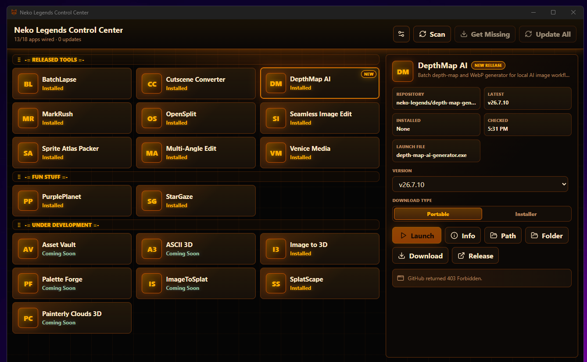

# Neko Legends Control Center

Neko Legends Control Center is a launcher and update hub for a growing collection of free Neko Legends / ForPublic tools, running on Linux ([Omarchy](https://omarchy.org)).

> **Windows is no longer supported.** Development has moved to Omarchy (Arch + Hyprland), and new tools and releases target Linux only. The Windows code paths and older Windows builds are still in the repo and on past releases, but they are no longer built, tested, or fixed.

The bigger goal is game development. I am building these tools while I build games, because making games is already hard enough without rebuilding the same helper utilities over and over. This collection is meant to give people useful open source tools for graphics, video, audio, workflow automation, and game starter projects so they can spend more time making games and less time making the tools around the game.

The tools are for humans building manually, humans working with AI agents, and AI agents that need automation-friendly utilities they can launch, inspect, modify, or extend. If we share the boring-but-necessary tools, everyone can move faster.

[](screenshot.png)

_Click the screenshot to view it at full size._

## What People Can Do With It

- Launch local Neko Legends tools from one compact desktop window.
- Scan GitHub releases and see which apps are installed, available, or ready to update.
- Download portable or installer builds per app. Portable is the default so launch usually works immediately.
- Pick or repair an app's launch path when a local executable needs to be selected manually.
- Open each app's GitHub README with the Info button.
- Open hosted demos for wallpaper art apps like StarGaze and PurplePlanet.
- Rearrange apps and categories with drag and drop.
- Switch themes, compact labels, and visible apps.
- Enable local AI Agent control for scripted status checks, downloads, updates, and launches.
- Discover the effective app/provider state through a credential-free capability provider catalog.
- Self-update the Control Center from the latest portable release when a newer version is available.

## Launching Apps

There are three ways to launch an installed app:

- Double-click the app tile.
- Right-click the app tile and choose Launch.
- Select the app, then click Launch in the details panel.

## Current Tools

Catalog snapshot: `catalog/tools.json` version 28, updated 2026-11-16.

### Released Tools

| App | Repository | Purpose |
| --- | --- | --- |
| BatchLapse | [neko-legends/BatchLapse](https://github.com/neko-legends/BatchLapse) | Batch video timelapse exporter for MP4, WebM, and GitHub-friendly GIFs. |
| Cutscene Converter | [neko-legends/CutsceneConverter](https://github.com/neko-legends/CutsceneConverter) | Prepare AI-generated videos for game engines with batch conversion, trimming, scaling, and combining. |
| DepthMap AI | [neko-legends/depth-map-generator](https://github.com/neko-legends/depth-map-generator) | Batch depth-map and WebP generator for local AI image workflows. |
| ImageToSplat | [neko-legends/ImageToSplat](https://github.com/neko-legends/ImageToSplat) | Turn a single image into a 3D Gaussian splat (.spz / .ply) and a textured, game-ready mesh (.glb). |
| MarkRush | [neko-legends/mark-rush](https://github.com/neko-legends/mark-rush) | Fast local Markdown viewer/editor built for huge files and folders. |
| Multi-Angle Edit | [neko-legends/multi-angle-edit](https://github.com/neko-legends/multi-angle-edit) | Re-render an existing image from a new camera angle with Qwen-Image-Edit plus the Multiple-Angles LoRA. |
| Neko Capture | [neko-legends/neko-capture](https://github.com/neko-legends/neko-capture) | Record any URL at an exact pixel size while you interact with it, or capture an app window, straight to MP4. |
| Omarchy Cut | [neko-legends/omarchy-cut](https://github.com/neko-legends/omarchy-cut) | Timeline video editor for Omarchy that plays and saves Shotcut (MLT) projects, with waveforms, speed, fades, and size/position/rotation. |
| OpenSplit | [neko-legends/open-split](https://github.com/neko-legends/open-split) | Multi-pane terminal harness for AI coding agents, shells, and SSH sessions. |
| Seamless Image Edit | [neko-legends/SeamlessImageEdit](https://github.com/neko-legends/SeamlessImageEdit) | Create seamless and tileable texture outputs from images or folders with seam repair, flattening, and 2x2 preview. |
| Sprite Atlas Packer | [neko-legends/sprite-atlas-packer](https://github.com/neko-legends/sprite-atlas-packer) | Turn loose sprite frames into deterministic TexturePacker-compatible PNG/WebP atlases. |
| Venice Media | [neko-legends/venice-media-local](https://github.com/neko-legends/venice-media-local) | Local Venice API media workspace for images, video, music, voice, and cleanup. |

### Hosted Demos And Fun Stuff

| App | Repository | Demo | Purpose |
| --- | --- | --- | --- |
| PurplePlanet | [neko-legends/PurplePlanet](https://github.com/neko-legends/PurplePlanet) | [Demo](https://nekolegends.com/res/projects/purplePlanet/) | Three.js planet motion art for live wallpapers and screensavers. |
| StarGaze | [neko-legends/StarGaze](https://github.com/neko-legends/StarGaze) | [Demo](https://nekolegends.com/res/projects/starGaze/) | Three.js starfield wallpaper and screensaver with tunable motion. |

### Not Yet Released

Tools without a public GitHub release stay in the catalog but are not shown in the launcher, so there is no Under Development section. A manual Scan, or the startup stale-release scan, shows an app under Released Tools as soon as its first release is found. Waiting for a release: Asset Vault, Palette Forge, SplatScape, and Painterly Clouds 3D.

## Dynamic Tool Catalog

The Control Center no longer needs a new app release every time a tool is added. It ships with a built-in fallback catalog, then tries to load the hosted catalog on startup:

```text
https://nekolegends.com/res/nekoLegendsControlCenter/tools.json
```

The repo copy lives at `catalog\tools.json`. Upload that file to the website path above when the public tool list changes.

Catalog behavior:

- If the hosted file loads, the app validates it, caches it locally, and uses it as the current tool list.
- If the hosted file is unavailable, the app uses the last cached catalog.
- If there is no cache yet, the app uses the built-in fallback list.
- The hosted file is metadata only. It can define tools, categories, colors, demo links, package preference, visibility, and status. It cannot define commands to run.
- The settings panel has a Remote catalog toggle. It is on by default. Turn it off to test the local `catalog\tools.json` before uploading it to the website.

Catalog status values:

- `available`: The tool can be shown as a normal tool. It only shows as `Available` after a GitHub release is known.
- `comingSoon`: The tool is not shown in the launcher until a public release is found, and stale release metadata is ignored.

Catalog convention: give `comingSoon` tools the category they should appear in once released (usually `Released Tools`). If a scan finds a public release for one, the Control Center promotes it to `available` and shows it. Older layouts that still have an `Under Development` section drop it. Reset Layout is only for restoring the default visual layout.

## Language Packs

Apps ship English only. The Control Center downloads fonts for other languages once into a shared folder (`%APPDATA%\NekoLegends\languages` on Windows) that every Neko Legends app reads, so no app has to bundle its own copies. Open them from the 文A button in the top bar or Settings → Languages.

Packs: Japanese, Chinese (Simplified), Korean, Russian/Cyrillic, Thai, and Arabic, built from OFL fonts and hosted next to `tools.json`. See [languages/README.md](languages/README.md) for the folder layout apps read, and how to build and publish packs.

## Status Labels

- `Installed`: A local launch file or wallpaper package is present.
- `Available`: A release exists, but the app has not been downloaded locally.
- `Update Ready`: A newer release exists than the locally installed version.
- `Downloading`: A download is currently running.

## Portable Build

Run:

```powershell
npm run build:portable
```

The build script creates one portable app and one installer:

- `release\portable\neko-legends-control-center-portable.exe`
- `release\installer\Neko Legends Control Center_<version>_x64-setup.exe`

The `release\portable` folder is the distribution-friendly portable package. Keep its `apps` and `catalog` folders beside `neko-legends-control-center-portable.exe`; downloaded apps install there by default, and local catalog testing reads from `catalog\tools.json`.

To launch the current portable build:

```powershell
npm run run:portable
```

The `src-tauri\target-*` folders are temporary build output. The `release\portable` and `release\installer` folders are the packages to upload, and generated build output is intentionally ignored by Git.

## Linux / Omarchy

The Control Center runs natively on Linux (tested on Omarchy: Arch + Hyprland, Wayland, NVIDIA).

**Install from a release:** download `Neko.Legends.Control.Center_<version>_amd64.AppImage` from the latest release, make it executable (`chmod +x`), and run it. On first run it adds itself to the app launcher (Super+Space on Omarchy), and it updates itself in place when a newer release is out.

**Install from source** (also adds the launcher entry):

```bash
scripts/install-omarchy.sh             # build + install to ~/.local
scripts/install-omarchy.sh --uninstall # remove it
```

A copy installed this way updates itself too: the first in-app update downloads the release AppImage into the Control Center's data folder and turns `~/.local/bin/neko-legends-control-center` into a small launcher for it. The app launcher entry stays the same.


This needs `webkit2gtk-4.1`, `gtk3`, and `libsoup3` (preinstalled on Omarchy) and Rust (`cargo` on PATH, or it uses `mise`'s `rust@stable`). Rerun it to update.

On Linux:

- Downloaded apps install to `~/.local/share/NekoLegends/apps`.
- The Control Center downloads `.AppImage` release assets (or `.zip` assets with `linux` in the name). Windows `.exe`/`.msi` assets are ignored, so an app whose release has no Linux build reports that when you try to download it.
- AppImages run without FUSE 2 by extracting on launch (`APPIMAGE_EXTRACT_AND_RUN=1`).
- Apps launched from the Control Center inherit `WEBKIT_DISABLE_DMABUF_RENDERER=1`, which avoids the WebKitGTK "Error 71" crash on Wayland with NVIDIA.

Releases are built by `.github/workflows/release.yml` when a `v*` tag is pushed. Only the Linux build is supported now (see the note at the top).

### Apps with Linux builds

Every released tool ships a Linux build, built in CI on Ubuntu 22.04 (Omarchy Cut on Arch) and tested on Omarchy. Their older Windows builds are no longer supported:

| App | First Linux release | Linux asset |
| --- | --- | --- |
| BatchLapse | v26.11.7 | AppImage |
| Cutscene Converter | v26.11.9 | AppImage (uses the system `ffmpeg`) |
| DepthMap AI | v26.11.7 | AppImage (sets up its own Python 3.12 + CUDA 12.8 runtime with `uv`) |
| Image to 3D | v26.11.7 | AppImage (Python 3.11 + CUDA 12.8 runtime via `uv`; builds its texture modules on first setup) |
| MarkRush | v26.11.7 | `markrush-linux-x86_64.zip` (native binary) |
| Multi-Angle Edit | v26.11.7 | AppImage (Python runtime via `uv`) |
| OpenSplit | v26.11.7 | AppImage |
| Seamless Image Edit | v26.11.7 | AppImage |
| Sprite Atlas Packer | v26.11.7 | AppImage |
| Venice Media | v26.11.7 | AppImage |
| ASCII 3D | v26.11.7 | AppImage |
| ImageToSplat | v26.11.9 | AppImage, Linux only for now (Python 3.12 runtime via `uv`; the mesh export needs the CUDA toolkit) |
| Neko Capture | v26.11.9 | AppImage, Linux only for now (Electron; nothing else to install) |
| Omarchy Cut | v0.1.0 | `omarchy-cut-linux-x86_64.zip` (native Qt binary, Linux only; uses the system's Qt and MLT: `sudo pacman -S --needed mlt sdl2-compat ffmpeg`) |

The AI tools need [`uv`](https://docs.astral.sh/uv/) on Linux (Omarchy includes it through mise; elsewhere `curl -LsSf https://astral.sh/uv/install.sh | sh`) because Omarchy's system Python (3.14) is newer than PyTorch and their model libraries support. PurplePlanet and StarGaze are web wallpapers: View Demo works everywhere, and their packages download on Linux too.

## Development

Install dependencies:

```powershell
npm install
```

Run the browser UI preview:

```powershell
npm run dev
```

Build the web assets:

```powershell
npm run build
```

Build the portable desktop app:

```powershell
npm run build:portable
```

Run the portable desktop app:

```powershell
npm run run:portable
```

The app is built with React, Vite, TypeScript, Tauri, and Rust.

## AI Agent Notes

### Capability Provider Catalog

Control Center atomically writes this additive discovery file under its existing AppData directory:

```text
%APPDATA%\com.nekolegends.controlcenter\capability-provider-catalog.v1.json
```

It combines the effective validated tool catalog, detected install/version state, merged Agent API registry metadata, existing file-command actions, and Control Center's implemented `app.*` capabilities. It does not replace or modify `catalog\tools.json`, the hosted catalog/cache, `agent-api-registry.json`, or Agent control inbox/outbox/history files.

The canonical document uses `apps[]`, `fileCommands[]`, and `capabilities[]`. App states are intentionally independent: `cataloged`, `installed`, `apiConfigured`, `apiReachable`, and `providerReady`. Control Center does not probe Agent API endpoints in this phase, so a configured port, URL, OpenAPI URL, `lastSeen`, or busy flag never makes `apiReachable` or `providerReady` true. The catalog contains no tokens, API keys, cookies, executable/package paths, or absolute registry/Agent control paths; sources use opaque IDs and well-known relative names.

For local debugging, the Tauri command `get_capability_provider_catalog` regenerates and returns the same document.

Start here when making changes:

- `src\App.tsx`: React UI, app layout, drag and drop, status labels, buttons, and frontend command calls.
- `src\styles.css`: themes, layout, app tiles, context menus, detail panel, responsive behavior.
- `src-tauri\src\main.rs`: app catalog defaults, saved state, GitHub release scanning, downloads, install detection, launching, demo/repo links, and self-update.
- `catalog\tools.json`: master catalog intended for upload to `https://nekolegends.com/res/nekoLegendsControlCenter/tools.json`.
- `scripts\build-portable.ps1`: portable build script that renames the Tauri exe and copies it into `release\portable`.
- `AGENTS.md`: local file-based Agent control protocol for automation.

Important source-of-truth details:

- The built-in fallback app catalog exists in `default_apps()` in `src-tauri\src\main.rs`.
- Browser fallback app defaults also exist in `fallbackState` in `src\App.tsx`.
- The GitHub owner is `neko-legends`.
- Hosted catalog entries must use stable `id` values. Do not rename an `id` once users may have saved paths or layouts for it.
- Increase `catalogVersion` when catalog defaults should replace older cached defaults.
- Use `status: "comingSoon"` for tools that are cataloged but not released; they stay hidden until a release is found.
- There is no `Under Development` category any more; give coming-soon tools the category they will be released into.
- The current version must stay aligned in `package.json`, `package-lock.json`, `src-tauri\Cargo.toml`, `src-tauri\Cargo.lock`, `src-tauri\tauri.conf.json`, and the GitHub user agent in `src-tauri\src\main.rs`.
- Portable output is generated and gitignored; do not commit `release` or `src-tauri\target-*`.
- There is a local untracked helper script, `scripts\generate-suite-letter-icons.ps1`, that may exist in a working tree. Do not stage it unless the user asks.

Before handing work back:

```powershell
npm run build
npm run build:portable
```

For UI changes, also preview the app and check the relevant desktop and mobile-sized layouts when possible.
